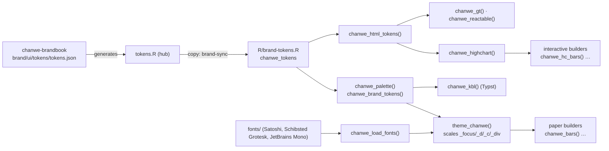
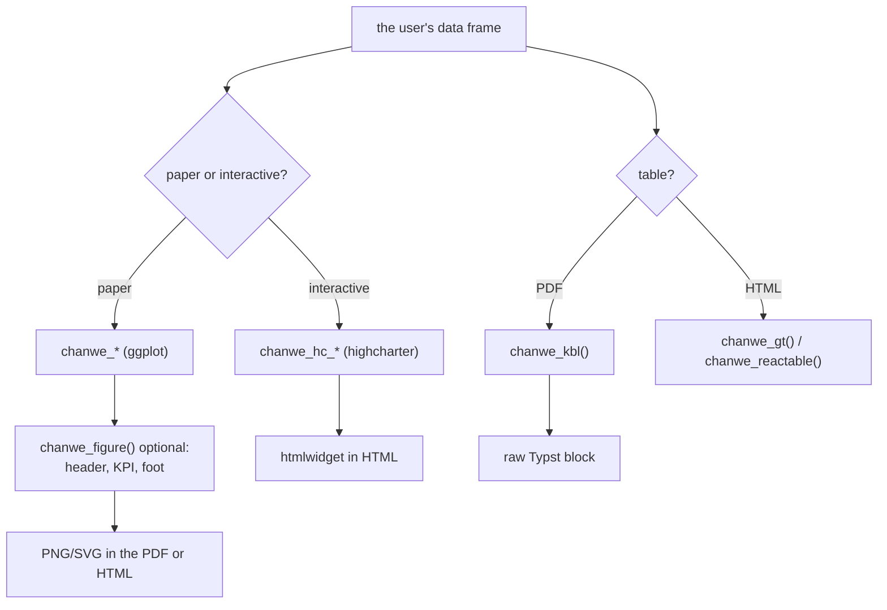

# chanwer: data tree

Checked against the code on 2026-11-19. chanwer keeps no data of its own: what flows is the brand's values, from
the hub to every chart and table, and the user's data, which comes in as a data frame and leaves as a chart.

## Where the values come from

| Value | Owner | Where chanwer reads it |
|---|---|---|
| Colours, radii, type, `plot.*` | the hub's `tokens.json` | `R/brand-tokens.R` (generated; never by hand) |
| Signal and context (`plot.focus`, `plot.slate`) | hub | `scale_*_chanwe_focus()`, `chanwe_focus_colors()`, every builder |
| Sign (`signed-positive/negative/neutral`) | hub | `chanwe_col_signed()`, `signed =`, the heatmap |
| Fonts | `chanwe-brandbook/brand/ui/fonts` | `inst/fonts`, `chanwe_load_fonts()` |

## From data to chart

## Who writes and who reads

| Piece | Written by | Read by |
|---|---|---|
| `R/brand-tokens.R` | the hub's brand-sync flow (PR `chore/brand-tokens`) | the whole package |
| `_extensions/` | a copy of chanwe-brand (the pinned version) | the showcases and the catalogue |
| `catalogue/external/*.jpg` | the catalogue's review render | `chanwer-catalogue.qmd` |
