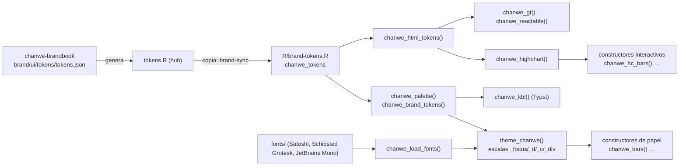
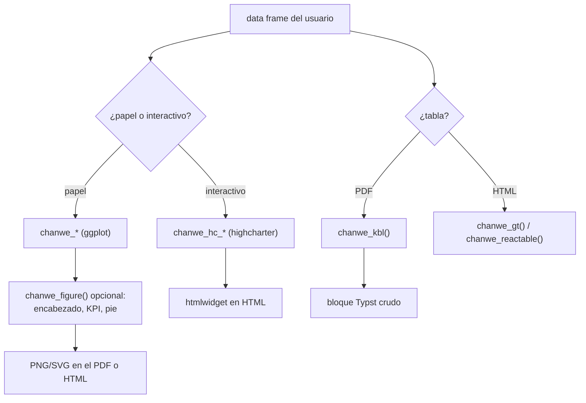

# chanwer: árbol de datos

Verificado contra el código el 2026-11-19. chanwer no guarda datos propios: lo único que "fluye" son los valores
de la marca, desde el hub hasta cada gráfico y tabla, y los datos del usuario, que entran como data frame y salen
como gráfico.

## De dónde salen los valores

| Valor | Dueño | Dónde lo lee chanwer |
|---|---|---|
| Colores, radios, tipografía, `plot.*` | `tokens.json` del hub | `R/brand-tokens.R` (generado; nunca a mano) |
| Señal y contexto (`plot.focus`, `plot.slate`) | hub | `scale_*_chanwe_focus()`, `chanwe_focus_colors()`, todos los constructores |
| Signo (`signed-positive/negative/neutral`) | hub | `chanwe_col_signed()`, `signed =`, el heatmap |
| Fuentes | `chanwe-brandbook/brand/ui/fonts` | `inst/fonts`, `chanwe_load_fonts()` |

## De los datos al gráfico

## Quién escribe y quién lee

| Pieza | La escribe | La leen |
|---|---|---|
| `R/brand-tokens.R` | el flujo brand-sync del hub (PR `chore/brand-tokens`) | todo el paquete |
| `_extensions/` | copia de chanwe-brand (la versión fijada) | los showcases y el catálogo |
| `catalogue/external/*.jpg` | el render de revisión del catálogo | `chanwer-catalogue.qmd` |
